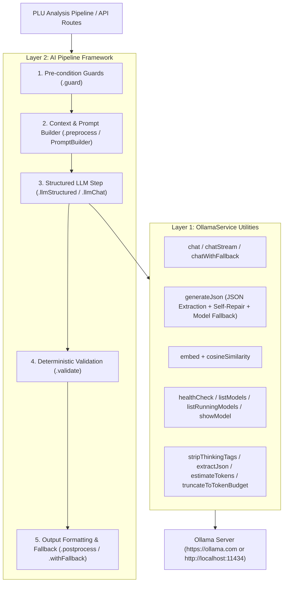

# Ollama Service & AI Pipeline Architecture

This document explains the two-layer AI architecture in **PLU Analyzer**:

1. **Layer 1 — `OllamaService` (`src/services/ollama/`)**: A comprehensive, strongly-typed service class wrapping the Ollama REST API with utilities for chat completions, streaming, raw generation, structured JSON extraction with self-repair, multi-model fallback, embeddings, reasoning (`<think>`) tag stripping, token budgeting, and server/model management.
2. **Layer 2 — AI Pipeline Framework (`src/services/ai-pipeline/`)**: A fluent, composable orchestration layer built on top of `OllamaService` for building deterministic, observable, fault-tolerant AI pipelines (`AiPipeline`, `PromptBuilder`, `PromptTemplate`, and pipeline presets).

---

## Architecture Overview



---

## 1. Configuration & Environment Variables

Configure Ollama in `.env` (see `.env.example`):

| Variable | Default | Description |
| :--- | :--- | :--- |
| `OLLAMA_BASE_URL` | `http://localhost:11434` | Base URL of the Ollama Cloud API (`https://ollama.com`) or local Ollama server (`OLLAMA_HOST` and `OLLAMA_API_URL` are also supported as fallbacks). |
| `OLLAMA_MODEL` | `qwen3:0.6b` | Fallback Ollama model tag used when no model is explicitly selected in the workspace or CMS (e.g., `gpt-oss:20b` in `.env`). |
| `OLLAMA_API_KEY` | _(empty)_ | Bearer token for Ollama Cloud (`https://ollama.com`) or an authenticated Ollama proxy/gateway. |
| `OLLAMA_TIMEOUT_MS` | `60000` | Default request timeout in milliseconds. |
| `OLLAMA_KEEP_ALIVE` | `5m` | How long Ollama keeps a model loaded in VRAM/RAM after a request (`5m`, `0`, `-1`). |
| `OLLAMA_DISABLED` | `false` | Set to `true` to bypass LLM synthesis and fall back directly to stored structured rules. |

---

## 2. Layer 1: `OllamaService` Reference

Located in [`src/services/ollama/OllamaService.ts`](../src/services/ollama/OllamaService.ts) with types in [`src/types/ollama.ts`](../src/types/ollama.ts).

### Instantiation & Configuration

```ts
import { getOllamaService, OllamaService } from '@/services/ollama'

// 1. Shared singleton configured from environment variables
const ollama = getOllamaService()

// 2. Custom instance with explicit overrides
const customOllama = new OllamaService({
  baseUrl: 'http://localhost:11434',
  defaultModel: 'qwen2.5:7b',
  defaultTimeoutMs: 90000,
  defaultOptions: {
    temperature: 0.1,
    num_ctx: 16384,
  },
})

// 3. Immutable clone with modified settings
const fastOllama = ollama.withConfig({
  defaultModel: 'qwen3:0.6b',
  defaultTimeoutMs: 15000,
})
```

### Core Chat & Completion Methods

#### `chat(input: OllamaChatInput): Promise<OllamaChatResult>`
Calls `POST /api/chat` (`stream: false`). Automatically separates `<think>...</think>` blocks emitted by reasoning models (such as `qwen3` or `deepseek-r1`) into `result.thinking` and returns clean response text in `result.content`.

```ts
const res = await ollama.chat({
  model: 'qwen3:0.6b',
  temperature: 0.1,
  messages: [
    { role: 'system', content: 'Tu es un assistant urbaniste français.' },
    { role: 'user', content: 'Résume la définition de l’emprise au sol.' },
  ],
})

if (res.ok) {
  console.log('Reply:', res.content)
  console.log('Reasoning trace:', res.thinking)
  console.log('Speed (tok/s):', res.metrics?.tokensPerSecond)
}
```

#### `chatWithFallback(input: OllamaChatWithFallbackInput): Promise<OllamaChatWithFallbackResult>`
Tries the primary model first, and automatically falls back through `fallbackModels` if a model is unavailable, times out, or returns an empty completion.

```ts
const res = await ollama.chatWithFallback({
  model: 'qwen2.5:7b',
  fallbackModels: ['qwen3:0.6b', 'llama3.2:3b'],
  messages: [{ role: 'user', content: 'Bonjour' }],
})
// res.attemptedModels -> ['qwen2.5:7b', 'qwen3:0.6b']
// res.warnings -> ['Model qwen2.5:7b failed: ...']
```

#### `chatStream(input: OllamaChatInput, onChunk?): AsyncGenerator<OllamaChatStreamChunk, OllamaChatResult>`
Streams NDJSON chunks from `POST /api/chat` (`stream: true`).

```ts
const stream = ollama.chatStream(
  {
    model: 'qwen3:0.6b',
    messages: [{ role: 'user', content: 'Explique le zonage UA.' }],
  },
  (chunk) => process.stdout.write(chunk.contentDelta),
)

for await (const chunk of stream) {
  if (chunk.done) {
    console.log('\nCompleted metrics:', chunk.metrics)
  }
}
```

#### `generate(input: OllamaGenerateInput): Promise<OllamaGenerateResult>`
Calls `POST /api/generate` for single-turn raw prompt completion.

#### `generateJson<T>(input: OllamaStructuredJsonInput<T>): Promise<OllamaStructuredJsonResult<T>>`
High-reliability structured JSON extraction utility:
- Sets Ollama's `format: schema ?? 'json'`.
- Strips `<think>...</think>` blocks and markdown code fences before extracting balanced `{...}` or `[...]`.
- Runs an optional `validate: (parsed: unknown) => T` function (works seamlessly with `zodSchema.parse` or custom validators).
- **Self-Repair Loop (`maxRepairAttempts`)**: If a model outputs malformed JSON or fails validation, sends a repair turn containing the exact parse/validation error message so the model can fix its own JSON before falling back to the next candidate model.

```ts
import { z } from 'zod'

const RuleSchema = z.object({
  maxHeightM: z.number().nullable(),
  maxCoverageRatio: z.number().min(0).max(1).nullable(),
})

const result = await ollama.generateJson({
  model: 'qwen3:0.6b',
  fallbackModels: ['llama3.2:3b'],
  systemPrompt: 'Extract PLU rules as JSON.',
  prompt: 'Article UA 10: Hauteur maximale 15m. Emprise au sol 60%.',
  maxRepairAttempts: 1,
  validate: (parsed) => RuleSchema.parse(parsed),
})

if (result.ok && result.data) {
  console.log(result.data.maxHeightM) // 15
}
```

### Embeddings & Vector Similarity

- **`embed(input: OllamaEmbedInput): Promise<OllamaEmbedResult>`**: Generates vector embeddings for a string or array of strings via `POST /api/embed`.
- **`OllamaService.cosineSimilarity(vecA, vecB): number`**: Computes cosine similarity in `[-1, 1]` between two embedding vectors.

### Server Diagnostics & Model Management

| Method | Endpoint | Description |
| :--- | :--- | :--- |
| `healthCheck()` | `/api/version`, `/api/tags`, `/api/ps` | Returns server status, version, latency, installed models, and loaded models in VRAM/RAM. |
| `getVersion()` | `GET /api/version` | Returns the Ollama server version string. |
| `listModels()` | `GET /api/tags` | Lists all locally installed models and their parameter sizes/families. |
| `listRunningModels()` | `GET /api/ps` | Lists models currently loaded in memory/VRAM. |
| `showModel(model)` | `POST /api/show` | Inspects a model's Modelfile, template, parameters, and capabilities. |
| `hasModel(model)` | `GET /api/tags` | Returns `true` if the model tag is installed locally. |
| `pullModel(model)` | `POST /api/pull` | Downloads a model from the Ollama library. |
| `deleteModel(model)` | `DELETE /api/delete` | Removes a local model. |
| `unloadModel(model)` | `POST /api/generate` | Unloads a model from VRAM immediately (`keep_alive: 0`). |

### Static Text & Token Utilities

- `OllamaService.stripThinkingTags(rawText)` — Separates `<think>...</think>` reasoning blocks from final content.
- `OllamaService.extractJson(rawText)` — Extracts a balanced JSON object or array from noisy LLM text.
- `OllamaService.parseJson<T>(rawText, validate?)` — Extracts, parses, and validates JSON in one call.
- `OllamaService.estimateTokens(text)` — Fast token count estimation.
- `OllamaService.truncateToTokenBudget(text, maxTokens)` — Truncates context cleanly at line/word boundaries to fit a token budget.

---

## 3. Layer 2: AI Pipeline Builder Framework

Located in [`src/services/ai-pipeline/`](../src/services/ai-pipeline/index.ts) with types in [`src/types/ai-pipeline.ts`](../src/types/ai-pipeline.ts).

### Design Principles of an Ideal AI Pipeline

An ideal production AI pipeline never treats an LLM call as an isolated string-in/string-out function. Instead, it separates deterministic responsibilities from probabilistic LLM reasoning:

1. **Pre-condition Guards (`.guard`)**: Short-circuit early when required source data is missing (e.g., 0 regulatory articles) so the LLM is never asked to guess or hallucinate.
2. **Context Budgeting & Structured Prompting (`.preprocess` + `PromptBuilder`)**: Format source chunks with explicit metadata and truncate to a deterministic token/character budget.
3. **Resilient Structured LLM Execution (`.llmStructured` / `.llmChat`)**: Enforce JSON output contracts, automatic `<think>` stripping, self-repair retries, and multi-model fallback chains.
4. **Deterministic Post-Validation (`.validate`)**: Verify citations, ranges, and domain invariants in TypeScript code rather than trusting the LLM to do math or validation.
5. **Graceful Degradation (`.withFallback`)**: Always provide a safe fallback output when the local daemon is offline or all candidate models fail.
6. **Full Telemetry (`AiPipelineResult`)**: Track every step's duration, attempt count, model used, token consumption, and warnings.

---

### Building Prompts with `PromptBuilder` & `PromptTemplate`

```ts
import {
  formatContextChunks,
  PromptBuilder,
  PromptTemplate,
} from '@/services/ai-pipeline'

const systemPrompt = PromptBuilder.create()
  .role('TON RÔLE', [
    'Tu es un extracteur strict de règles d’urbanisme PLU.',
  ])
  .constraints('INTERDICTIONS ABSOLUES', [
    'Ne rien inventer.',
    'Ne rien calculer.',
  ])
  .examples('EXEMPLES', {
    forbidden: ['Arrondir 0,80 m à 1 m'],
    allowed: ['Recopier "0,80 mètre" avec citation exacte'],
  })
  .outputJsonContract('Renvoyer uniquement un objet JSON valide :', {
    maxHeightM: 15,
    maxCoverageRatio: 0.6,
  })
  .build()

const userTemplate = PromptTemplate.from<{
  commune: string
  zone: string
  excerpts: string
}>([
  'Commune: {{commune}}',
  'Zone: {{zone}}',
  '',
  'Extraits officiels:',
  '{{excerpts}}',
])
```

---

### Composing Pipelines with `AiPipeline`

`AiPipeline.create<TInput, TContext>()` provides a fluent, type-safe chain where each step transforms the output type of the previous step:

```ts
import { AiPipeline } from '@/services/ai-pipeline'

interface RegulationInput {
  zoneCode: string
  articles: Array<{ id: string; text: string }>
}

interface ExtractedRules {
  maxHeightM: number | null
  maxCoverageRatio: number | null
}

const pipeline = AiPipeline.create<RegulationInput>({
  name: 'custom-plu-extractor',
  hooks: {
    onStepComplete: (trace) => {
      console.log(`[Pipeline] Step ${trace.step} (${trace.kind}): ${trace.status} in ${trace.durationMs}ms`)
    },
  },
})
  // 1. Guard: Short-circuit if no articles exist
  .guard(
    'ensure_articles_present',
    (input) => input.articles.length > 0,
    () => ({
      maxHeightM: null,
      maxCoverageRatio: null,
      status: 'insufficient_data' as const,
    }),
  )
  // 2. Preprocess: Format context chunks within token budget
  .preprocess('prepare_context', (input) => ({
    ...input,
    formattedContext: input.articles.map((a) => `[${a.id}]\n${a.text}`).join('\n\n'),
  }))
  // 3. LLM Structured Extraction with Self-Repair & Fallback
  .llmStructured<ExtractedRules>('extract_rules_llm', {
    model: 'qwen3:0.6b',
    fallbackModels: ['qwen2.5:7b', 'llama3.2:3b'],
    systemPrompt: 'Extract maxHeightM and maxCoverageRatio as JSON.',
    userPrompt: (ctxInput) => `Zone: ${ctxInput.zoneCode}\n\n${ctxInput.formattedContext}`,
    maxRepairAttempts: 1,
    validate: (parsed) => {
      const obj = parsed as Record<string, unknown>
      return {
        maxHeightM: typeof obj.maxHeightM === 'number' ? obj.maxHeightM : null,
        maxCoverageRatio:
          typeof obj.maxCoverageRatio === 'number' ? obj.maxCoverageRatio : null,
      }
    },
  })
  // 4. Deterministic Validation
  .validate('validate_ratios', (llmResult, ctx) => {
    const rules = { ...llmResult.data }
    if (rules.maxCoverageRatio !== null && rules.maxCoverageRatio > 1) {
      ctx.addWarning('Coverage ratio > 1 detected; normalizing percentage to ratio.')
      rules.maxCoverageRatio = Number((rules.maxCoverageRatio / 100).toFixed(4))
    }
    return {
      ...rules,
      status: 'ok' as const,
    }
  })
  // 5. Fallback if Ollama is offline
  .withFallback((error) => ({
    maxHeightM: null,
    maxCoverageRatio: null,
    status: 'error' as const,
    error: error.message,
  }))

const result = await pipeline.execute({
  zoneCode: 'UA',
  articles: [{ id: 'Art. 10', text: 'La hauteur maximale est fixée à 15 mètres.' }],
})

console.log(result.output)       // { maxHeightM: 15, maxCoverageRatio: null, status: 'ok' }
console.log(result.totalTokens)  // { promptTokens, completionTokens, totalTokens }
console.log(result.steps)        // Detailed trace for each step
```

---

### Pipeline Step Reference

| Builder Method | Kind | Purpose |
| :--- | :--- | :--- |
| `.guard(name, predicate, onShortCircuit)` | `guard` | Evaluates a predicate; if `false`, stops execution immediately and returns `onShortCircuit(input, ctx)` with `status: 'short_circuited'`. |
| `.preprocess(name, fn, options?)` | `preprocess` | Prepares, normalizes, or chunks input data before LLM execution. |
| `.step(name, fn, options?)` | `transform` | Runs any arbitrary synchronous or asynchronous transformation. |
| `.llmChat(name, config, options?)` | `llm_chat` | Runs a chat completion with `OllamaService.chatWithFallback`. |
| `.llmStructured<T>(name, config, options?)` | `llm_structured` | Runs structured JSON extraction with `OllamaService.generateJson` (includes self-repair and model fallbacks). |
| `.validate(name, validator, options?)` | `validate` | Runs deterministic post-LLM verification or rule/citation checks. |
| `.postprocess(name, fn, options?)` | `postprocess` | Formats the final pipeline output object. |
| `.branch(name, condition, onTrue, onFalse)` | `branch` | Routes execution conditionally between two handlers. |
| `.parallel(name, tasks)` | `parallel` | Executes multiple sub-tasks concurrently via `Promise.all` and returns a typed tuple of results. |
| `.withFallback(handler)` | — | Catches any unhandled pipeline failure and returns a safe fallback output (`status: 'fallback'`). |

---

### Built-in Pipeline Presets (`src/services/ai-pipeline/presets.ts`)

1. **`createStructuredExtractionPipeline(config)`**:
   Pre-wires the standard `Guard -> Prompt Formatting -> LLM Structured Extraction (with Self-Repair & Model Fallbacks) -> Output Formatter -> Graceful Fallback` pattern. Used directly by [`src/services/plu/ollama-interpreter.ts`](../src/services/plu/ollama-interpreter.ts).
2. **`createMapReducePipeline(config)`**:
   Splits large document sets into chunks (`splitChunks`), runs an extraction/summarization pass over each chunk (`mapChunk`), and aggregates all chunk outputs into a final synthesis (`reduceResults`).
3. **`createCritiqueRefinePipeline(config)`**:
   Generates an initial draft (`generateDraft`), critiques it deterministically or via a verifier prompt (`critiqueDraft`), and branches either to immediate approval (`finalizeApproved`) or a targeted refinement pass (`refineDraft`).

---

## 4. End-to-End PLU Analysis Integration & Model Resolution

When a PLU feasibility analysis runs in [`src/services/plu/pipeline.ts`](../src/services/plu/pipeline.ts), the platform resolves the active Ollama model and fallback chain before invoking [`interpretRegulationsWithOllama`](../src/services/plu/ollama-interpreter.ts):

1. **Model Resolution Order**:
   1. Explicit `input.aiModel` selected by the user for the analysis.
   2. Global `workspace-settings.defaultAiModel` configured in Payload CMS.
   3. The `ai-models` collection entry marked `isDefault: true` (seeded via [`src/seed/ai-models.ts`](../src/seed/ai-models.ts)).
   4. The first active entry in `ai-models`.
   5. `process.env.OLLAMA_MODEL`, falling back to `DEFAULT_OLLAMA_MODEL`.
2. **Automatic Fallback Chain**:
   All other active models in `ai-models` are passed as `fallbackModels`. If the primary model fails, times out, or returns invalid JSON, `OllamaService.generateJson()` automatically retries with the next model in the list.
3. **Structured Regulatory Interpretation**:
   `interpretRegulationsWithOllama` runs `createStructuredExtractionPipeline` to:
   - Short-circuit safely if `OLLAMA_DISABLED=true` or 0 regulatory articles are available (never fabricating rules).
   - Format extracted PLU articles within a token budget.
   - Extract structured feasibility rules and citations via `OllamaService.generateJson` (with self-repair if JSON parsing fails).
   - Merge AI-extracted rules with deterministic stored rules and return traceable citations, warnings, and token metrics.
